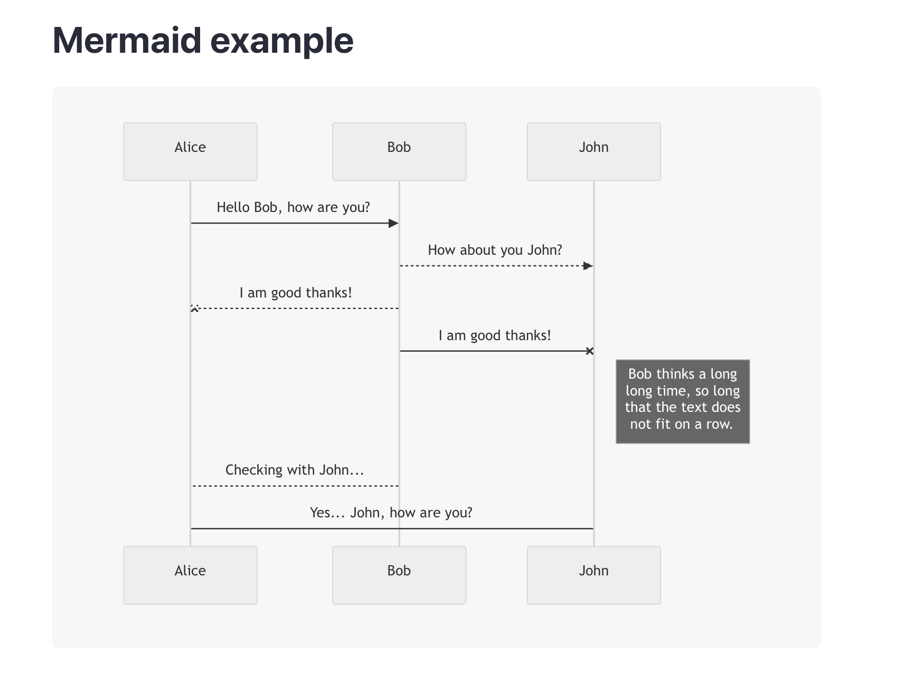
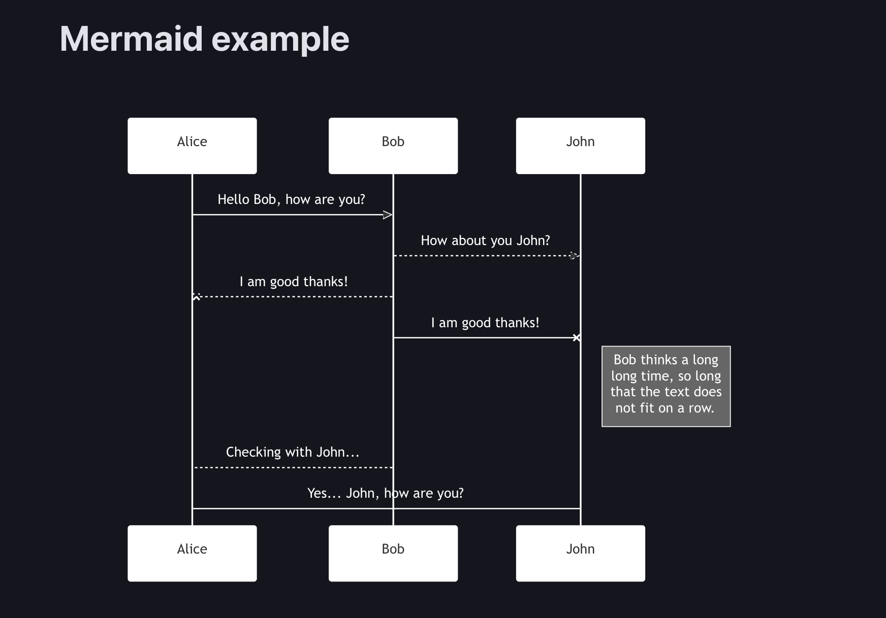
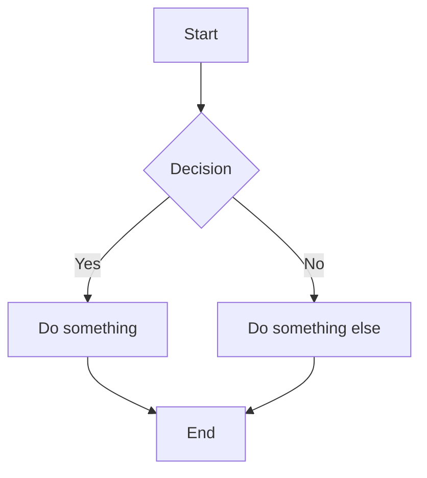

# Mermaid Plugin

Render [Mermaid.js](https://mermaid.js.org/) diagrams inside your Publii posts and pages. Supports both the Markdown editor and the WYSIWYG editor's code sample dialog.




---

## ✨ Features

- Supports Mermaid diagrams via fenced code blocks in the Markdown editor
- Supports the WYSIWYG editor's Insert → Code Sample dialog (see setup below)
- Automatically loads the Mermaid.js library
- Light/dark mode support via CSS filter
- Works in posts, pages, and excerpts

---

## Usage

### Markdown editor

Use a fenced code block with the `mermaid` language identifier:

````markdown

````

### WYSIWYG editor

To add Mermaid to the **Insert → Code Sample** language dropdown, create a `tinymce.override.json` file in your Publii config directory:

**macOS:** `~/Documents/Publii/config/tinymce.override.json`  
**Windows:** `%USERPROFILE%\Documents\Publii\config\tinymce.override.json`  
**Linux:** `~/.config/Publii/config/tinymce.override.json`

Paste the full language list with Mermaid added (example below). Restart Publii, then select **Mermaid** from the language dropdown when inserting a code sample.

<details>
<summary>Example tinymce.override.json</summary>

```json
{
    "codesample_languages": [
        { "text": "Apache Configuration", "value": "apacheconf" },
        { "text": "ASP.NET", "value": "aspnet" },
        { "text": "Bash", "value": "bash" },
        { "text": "BASIC", "value": "basic" },
        { "text": "Batch", "value": "batch" },
        { "text": "BBcode", "value": "bbcode" },
        { "text": "C", "value": "c" },
        { "text": "C++", "value": "cpp" },
        { "text": "C#", "value": "csharp" },
        { "text": "CSS", "value": "css" },
        { "text": "Docker", "value": "docker" },
        { "text": "Git", "value": "git" },
        { "text": "Go", "value": "go" },
        { "text": "GraphQL", "value": "graphql" },
        { "text": "HTML", "value": "html" },
        { "text": "HTTP", "value": "http" },
        { "text": "Java", "value": "java" },
        { "text": "JavaScript", "value": "javascript" },
        { "text": "JSON", "value": "json" },
        { "text": "Kotlin", "value": "kotlin" },
        { "text": "LaTeX", "value": "latex" },
        { "text": "LESS", "value": "less" },
        { "text": "Lua", "value": "lua" },
        { "text": "Markdown", "value": "markdown" },
        { "text": "Mermaid", "value": "mermaid" },
        { "text": "Nginx", "value": "nginx" },
        { "text": "Objective-C", "value": "objectivec" },
        { "text": "PHP", "value": "php" },
        { "text": "PowerShell", "value": "powershell" },
        { "text": "Python", "value": "python" },
        { "text": "R", "value": "r" },
        { "text": "Regex", "value": "regex" },
        { "text": "Ruby", "value": "ruby" },
        { "text": "Rust", "value": "rust" },
        { "text": "Sass", "value": "sass" },
        { "text": "SCSS", "value": "scss" },
        { "text": "SQL", "value": "sql" },
        { "text": "Swift", "value": "swift" },
        { "text": "TypeScript", "value": "typescript" },
        { "text": "YAML", "value": "yaml" },
        { "text": "XML", "value": "markup" }
    ]
}
```

</details>
